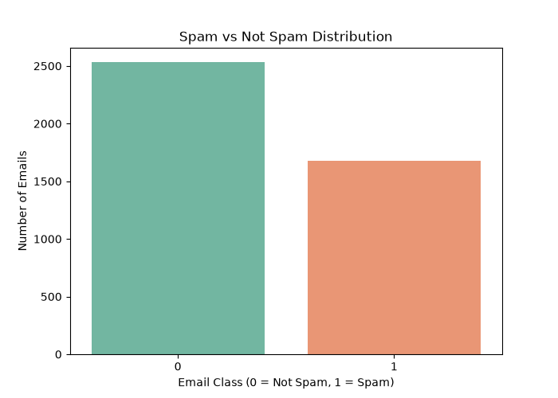

📧 Email Spam Detection using Machine Learning

<strong>A Machine Learning-based Email Spam Detection System built using Python, Scikit-learn, and Streamlit.</strong>

📌 Project Overview

Email spam is one of the most common problems in digital communication. Unwanted emails can contain misleading information, advertisements, phishing attempts, and potentially harmful content.

This project develops a Machine Learning-based Email Spam Detection System that classifies emails into two categories:

Spam (1): Unwanted or suspicious emails.
Not Spam (0): Legitimate emails.

The system uses the Spambase dataset, performs data preprocessing and exploratory data analysis, trains a Logistic Regression classification model, and provides an interactive interface using Streamlit.

The trained model achieved an accuracy of 93.47% on the test dataset.

🎯 Project Objectives
Analyze email-related numerical features using data analysis techniques.
Clean and preprocess the dataset.
Explore the distribution of spam and legitimate emails.
Train a Machine Learning classification model.
Evaluate model performance using standard classification metrics.
Build an interactive web application using Streamlit.
Predict whether an email is spam or not spam based on its numerical features.
🛠️ Technologies Used
Technology	Purpose
Python	Core programming language
Pandas	Data manipulation and preprocessing
NumPy	Numerical operations
Matplotlib	Data visualization
Seaborn	Statistical visualization
Scikit-learn	Machine Learning and model evaluation
Logistic Regression	Classification algorithm
StandardScaler	Feature scaling
Joblib	Model serialization
Streamlit	Interactive web application
Git & GitHub	Version control and project hosting
📂 Dataset Information

This project uses the Spambase email classification dataset.

Dataset overview:

Description	Value
Original records	4,601
Records after removing duplicates	4,210
Input features	57
Target variable	Class
Missing values	0

The dataset contains numerical features representing word frequencies, character frequencies, and capital-letter patterns in emails.

Target variable:

0 – Not Spam
1 – Spam
⚙️ Project Workflow

The project follows these steps:

Data Collection: Load the original email dataset.
Data Preprocessing: Remove duplicate records and check missing values.
Exploratory Data Analysis: Analyze the dataset and visualize spam distribution.
Feature Selection: Separate the 57 input features from the target variable.
Data Splitting: Divide the dataset into training and testing sets using an 80:20 ratio.
Feature Scaling: Apply StandardScaler to standardize numerical features.
Model Training: Train a Logistic Regression classification model.
Model Evaluation: Evaluate the model using accuracy, precision, recall, F1-score, and confusion matrix.
Model Saving: Save the trained model using Joblib.
Web Application: Build an interactive Streamlit application for email classification.
🤖 Machine Learning Model

The project uses Logistic Regression for binary classification.

A Scikit-learn Pipeline combines:

StandardScaler
Logistic Regression

The dataset is divided into:

Training data: 80% (3,368 records)
Testing data: 20% (842 records)

The model uses a stratified train-test split with random_state=42 to maintain class distribution and reproducibility.

📊 Model Performance

The trained model achieved:

Classification Report
Class	Precision	Recall	F1-Score
Not Spam (0)	0.94	0.95	0.95
Spam (1)	0.93	0.90	0.92
Macro Average	0.93	0.93	0.93
Weighted Average	0.93	0.93	0.93
Confusion Matrix
	Predicted Not Spam	Predicted Spam
Actual Not Spam	483	23
Actual Spam	32	304

Interpretation:

483 legitimate emails were correctly classified.
304 spam emails were correctly detected.
23 legitimate emails were incorrectly classified as spam.
32 spam emails were incorrectly classified as legitimate.

These results indicate that the model performs well on the held-out test dataset.

🖥️ Application Features

The project includes a Streamlit-based web application.

Features include:

Interactive numerical feature inputs.
One-click email classification.
Spam and Not Spam prediction.
Spam probability display.
Not Spam probability display.
Simple and user-friendly interface.

The current application expects numerical email features rather than raw email text.

📸 Data Visualization

The project includes a visualization of spam and legitimate email distribution.

!Spam Distribution

📁 Project Structure
text
Email-Spam-Detection-ML/
│
├── dataset/
│   ├── spambase.csv
│   ├── cleaned_spambase.csv
│   └── spam_distribution.png
│
├── models/
│   └── spam_model.pkl
│
├── app.py
├── preprocessing.py
├── model_training.py
├── visualization.py
├── eda.py
├── train_model.py
│
├── requirements.txt
├── README.md
├── LICENSE
└── .gitignore

🚀 Installation and Setup

Follow these instructions to run the project locally.

1. Clone the Repository
bash
git clone https://github.com/Ahana-Bhattacharya/Email-Spam-Detection-ML.git

2. Navigate to the Project Directory
bash
cd Email-Spam-Detection-ML

3. Create a Virtual Environment
bash
python -m venv venv

4. Activate the Virtual Environment

Windows PowerShell:

powershell
.\venv\Scripts\Activate.ps1

Linux / macOS:

bash
source venv/bin/activate

5. Install Dependencies
bash
pip install -r requirements.txt

▶️ Running the Project

Run the following scripts in order.

Step 1: Data Preprocessing
bash
python preprocessing.py

This script removes duplicate records, checks missing values, and generates the cleaned dataset.

Step 2: Model Training
bash
python model_training.py

This script trains the Logistic Regression model, evaluates its performance, and saves the trained model.

Note: The model must be saved at models/spam_model.pkl because that is the location expected by app.py. Ensure the save path in model_training.py is:

python
joblib.dump(model, "models/spam_model.pkl")

Step 3: Generate Visualizations
bash
python visualization.py

This script generates and saves the spam distribution visualization.

Step 4: Launch the Streamlit Application
bash
streamlit run app.py

Open the local URL displayed in your terminal, usually:

text
http://localhost:8501

📈 Future Improvements

Some possible improvements for future versions include:

Implementing additional classification algorithms such as Random Forest, Naive Bayes, and Support Vector Machine.
Comparing different models to identify the best-performing classifier.
Adding raw email text input instead of requiring manual numerical feature entry.
Integrating automatic email feature extraction.
Improving the user interface and adding interactive charts.
Deploying the application using Streamlit Community Cloud.
Adding more evaluation metrics and model comparison visualizations.
💡 Key Learnings

Through this project, I gained practical experience in:

Data cleaning and preprocessing.
Exploratory Data Analysis (EDA).
Feature scaling and classification.
Logistic Regression.
Model evaluation and performance analysis.
Building interactive applications using Streamlit.
Saving and loading Machine Learning models.
Version control using Git and GitHub.
👩‍💻 Author

Ahana Bhattacharya

GitHub: Ahana-Bhattacharya

Project Repository: Email Spam Detection using Machine Learning

📜 License

This project is licensed under the MIT License. See the LICENSE file for details.

<strong>⭐ If you find this project interesting, consider giving it a star!</strong>

Made with ❤️ using Python and Machine Learning.

